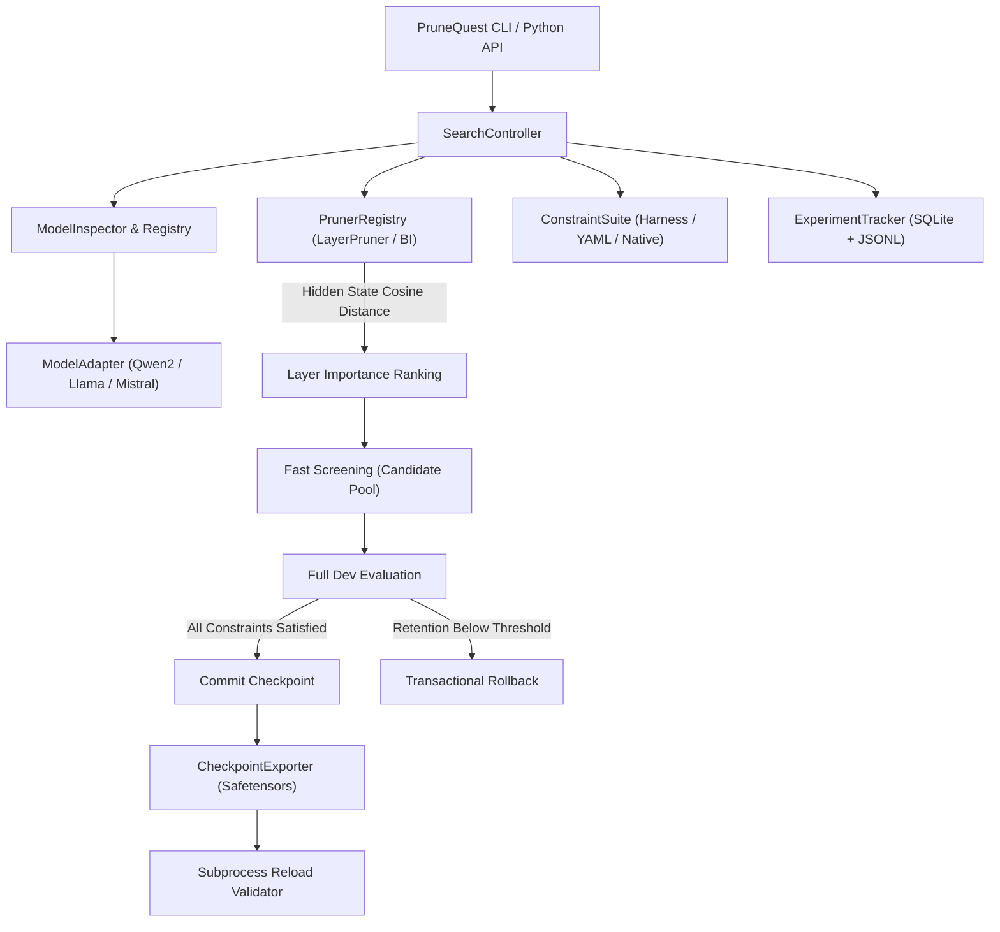

# PruneQuest: Universal Benchmark-Driven LLM Pruning Framework

[](https://github.com/kaushikharsh99/PruneQuest/actions)
[](https://opensource.org/licenses/Apache-2.0)
[](https://www.python.org/downloads/)
[](https://pytorch.org/)
[](https://huggingface.co/)
[](https://github.com/EleutherAI/lm-evaluation-harness)

**PruneQuest** is an open-source, universal, benchmark-driven structural pruning framework designed to compress Large Language Models while strictly enforcing user-defined performance retention constraints.

Instead of applying blind heuristics or non-functional weight masking, PruneQuest **physically prunes transformer layers**, verifies functional integrity across single or multi-benchmark suites, and enforces strict directional performance retention thresholds (e.g. $\ge 99\%$ retention) with automatic transactional rollback.

---

## Key Highlights

- **Universal Architecture Discovery**: Automatic config inspection classifying models into `decoder_only_dense`, `mixture_of_experts`, `encoder_decoder`, `hybrid_ssm`, or `quantized` without heavy tensor downloads.
- **Multi-Family Support**: Production-verified adapters for **Qwen2/2.5**, **Llama-2/3**, and **Mistral**, with experimental adapters for **Gemma** and **Phi**.
- **EleutherAI LM-Evaluation Harness**: Native support for **14,222+ benchmarks** (GSM8K, ARC, HellaSwag, MMLU, Winogrande, etc.) evaluated in-memory without GPU memory duplication.
- **Declarative YAML `BenchmarkSpec`**: Define custom tasks from Hugging Face datasets, JSON/JSONL, CSV, or Parquet with built-in scorers (`exact_match`, `math_verify`, `normalized_match`, `regex`).
- **Multi-Benchmark `ConstraintSuite`**: Require candidates to satisfy retention thresholds across multiple benchmarks simultaneously before acceptance.
- **Physical Parameter Reduction**: Physically deletes transformer blocks from `torch.nn.ModuleList`, reducing parameter count, VRAM, and disk storage.
- **ShortGPT Block Influence Guidance**: Ranks candidate layers by token-level cosine distance across hidden representations, pruning redundant identity-like layers first.
- **Hardware-Conscious (6 GB VRAM Safe)**: Validated on an NVIDIA GeForce RTX 3050 Laptop GPU (6 GB VRAM, 16 GB RAM), with automatic garbage collection, CUDA cache clearing, and zero redundant allocations.
- **Production Checkpoint Export**: Saves standalone Hugging Face `safetensors` checkpoints with complete provenance metadata and verifies them via out-of-process reload testing.
- **CLI & Python API**: Feature-complete Rich / Typer CLI and Python API.

---

## Model Architecture Support & Capability Tiers

| Family | Architecture Class | Capability Level | Supported Pruning Operations |
| :--- | :--- | :--- | :--- |
| **Qwen 2 / 2.5** | `decoder_only_dense` | **Level 3 (Verified)** | Physical layer removal, Block Influence scoring |
| **Llama 2 / 3 / 3.1 / 3.2** | `decoder_only_dense` | **Level 3 (Verified)** | Physical layer removal, Block Influence scoring |
| **Mistral / Zephyr** | `decoder_only_dense` | **Level 3 (Verified)** | Physical layer removal, Block Influence scoring |
| **Gemma / Gemma-2** | `decoder_only_dense` | **Level 2 (Experimental)** | Physical layer removal (experimental normalization sync) |
| **Phi-2 / Phi-3 / 3.5** | `decoder_only_dense` | **Level 2 (Experimental)** | Physical layer removal (experimental RoPE/partial rotary) |
| **Mixtral / Qwen-MoE** | `mixture_of_experts` | **Level 1 (Evaluation)** | Benchmark evaluation supported; expert pruning in dev |

---

## Empirical Exploration: Qwen2.5-Math-1.5B on GSM8K

During preliminary experimental exploration on an NVIDIA GeForce RTX 3050 Laptop GPU (6 GB VRAM), multiple structural compression techniques were evaluated on `Qwen/Qwen2.5-Math-1.5B-Instruct` across deterministic GSM8K splits:

| Checkpoint | Parameter Count | GSM8K Accuracy (16-sample smoke split) | Accuracy Retention | VRAM Allocated | Latency / Sample | Modality & Description |
| :--- | :--- | :--- | :--- | :--- | :--- | :--- |
| **Baseline (Original)** | 1,543.71M | 100.00% (16/16) | 100.00% | 2.90 GB | 1.83 s | Full 28 Layers, unpruned reference |
| **Pruned (`mlp_red_5`)** | **1,485.91M** | **100.00% (16/16)** | **100.00%** | **2.88 GB** | **1.71 s** | Experimental MLP intermediate channel slicing (-57.8M params) |
| **Pruned (`checkpoint_layers_25`)** | 1,403.32M | 81.25% (13/16) | 81.25% | 2.74 GB | 1.54 s | Block Influence layer pruning (25 of 28 layers retained) |
| **Control (`random_layer_2`)** | 1,496.92M | 87.50% (14/16) | 87.50% | 2.82 GB | 1.76 s | Naive random layer removal control |

> **Methodological Note on Benchmark Size**: A 16-sample smoke test confirms generation and answer extraction integrity, but has wide confidence intervals ($\pm 18\%$). PruneQuest implements **two-phase benchmark validation**: fast candidate screening on candidate subsets, followed by rigorous candidate acceptance evaluation on the full development benchmark split (e.g. 512 samples) or full GSM8K test set (1,319 samples) before committing any checkpoint.

---

## Architecture Overview



---

## Quickstart

### 1. Installation

```bash
git clone https://github.com/kaushikharsh99/PruneQuest.git
cd PruneQuest
pip install -e .
```

### 2. Verify Your Environment

```bash
prunequest doctor
```

### 3. Inspect Target Model

```bash
prunequest inspect --model meta-llama/Llama-3.2-1B-Instruct
prunequest inspect --model Qwen/Qwen2.5-Math-1.5B-Instruct
```

### 4. Discover Benchmarks

```bash
# List top discovered benchmarks
prunequest benchmarks list --limit 20

# Search available benchmarks
prunequest benchmarks search math
prunequest benchmarks search gsm8k

# Inspect task details
prunequest benchmarks info gsm8k
```

### 5. Launch Pruning Search

#### Stage 1: Structured Width / MLP Channel Pruning (FLAP)
Fluctuation-based Adaptive Structured Pruning on SwiGLU MLP intermediate projections with automatic step-back halving ($5\% \to 2.5\% \to 1.25\% \to 0.6125\%$) and VRAM-aware batched evaluation (up to batch size 64):
```bash
# Using prunequest CLI
prunequest stage1 optimize --config configs/qwen_math_stage1.yaml

# Or using the stage1 direct alias
stage1 optimize --config configs/qwen_math_stage1.yaml --batch-size 32
```

#### Stage 2: Structured Depth / Layer Pruning
Autonomous search controller pruning redundant transformer blocks based on Block Influence hidden state cosine distance:
```bash
# Multi-benchmark pruning search with 99% retention target
prunequest stage2 run \
    --model Qwen/Qwen2.5-Math-1.5B-Instruct \
    --benchmark gsm8k \
    --retain 0.99 \
    --max-iterations 3 \
    --split smoke \
    --output ./runs/qwen_stage2_run
```

### 6. Python API Example

```python
from prunequest import PruneQuest

quest = PruneQuest(
    model="Qwen/Qwen2.5-Math-1.5B-Instruct",
    benchmarks=["gsm8k"],
    retain=0.99,
    max_iterations=3,
    split="smoke",
)

result = quest.run()

print(f"Status: {result.status}")
print(f"Best checkpoint exported to: {result.best_checkpoint}")
print(f"Parameters pruned: {result.original_params - result.final_params:,}")
print(f"Final accuracy retention: {result.accuracy_retention_pct:.2f}%")
```

---

## Declarative Benchmark Specifications

PruneQuest allows custom benchmarks to be specified via declarative YAML:

```yaml
version: 1
name: custom_qa
dataset:
  path: json
  data_files: data/qa.jsonl
prompt_template: "Question: {question}\nAnswer:"
scoring:
  metric: exact_match
splits:
  dev:
    samples: 100
  test:
    samples: 500
```

Validate and preview YAML specs using the CLI:

```bash
prunequest benchmarks validate --spec benchmark.yaml
prunequest benchmarks preview --spec benchmark.yaml --limit 3
```

---

## Repository Structure

```
PruneQuest/
|-- .github/workflows/tests.yml   # Automated GitHub Actions CI workflow
|-- configs/default.yaml          # Pydantic-validated default configuration
|-- docs/                         # Comprehensive documentation suite
|   |-- architecture.md           # Modular subsystem design & rollback engine
|   |-- benchmarks.md             # Benchmark protocol & LM-Eval integration
|   |-- compatibility.md          # Multi-architecture capability matrix
|   |-- extending.md              # Adding custom models, pruners, and benchmarks
|   |-- migration-v0.2.md         # v0.2.0 evolution plan & release architecture
|   `-- quickstart.md             # Getting started guide
|-- src/prunequest/               # Core framework source code
|   |-- api.py                    # High-level Python API (PruneQuest)
|   |-- cli.py                    # Rich / Typer CLI commands
|   |-- config.py                 # Pydantic V2 settings schema
|   |-- benchmarks/               # LM-Eval Harness adapter, YAML specs & constraints
|   |-- core/                     # Search controller & transactional tracking
|   |-- export/                   # Safetensors exporter & reload validation
|   |-- models/                   # Discovery, decoder surgery, Qwen2, Llama, Mistral, Gemma, Phi
|   |-- pruning/                  # Block Influence scoring & pruner registry
|   `-- reporting/                # Plot generation & Markdown summaries
|-- tests/                        # Comprehensive unit & integration test suite
|-- LICENSE                       # Apache-2.0 License
|-- pyproject.toml                # Standard PEP 517/621 packaging metadata
`-- README.md                     # Framework documentation & empirical results
```

---

## Roadmap

- [x] **v0.1.0**: Initial foundational release (Qwen2 adapter, layer pruning, Block Influence, GSM8K, Typer CLI, SQLite tracking).
- [x] **v0.1.1**: Reliability & Benchmark Correctness (Two-phase candidate screening and dev benchmark validation, baseline preservation on resume, subprocess reload validation rejection safeguards, strict Ruff CI pass, expanded offline unit testing suite).
- [x] **v0.2.0**: Universal LLM Pruning Framework (ModelInspector architecture discovery, 4 capability tiers, LLaMA-2/3, Mistral, Gemma, and Phi adapters, LM Evaluation Harness integration with 14,222+ tasks, declarative YAML BenchmarkSpec compiler, directional MetricSpec and multi-benchmark ConstraintSuite).
- [ ] **v0.3.0**: Automated Granular Pruning: MLP intermediate channel slicing, attention head pruning with dynamic projection recalculation, and multi-GPU DDP search support.

---

## Contributing

Contributions are warmly welcomed! Please see [CONTRIBUTING.md](CONTRIBUTING.md) and [CODE_OF_CONDUCT.md](CODE_OF_CONDUCT.md) for details on filing issues, opening PRs, and running tests.

---

## License

PruneQuest is licensed under the [Apache-2.0 License](LICENSE).
