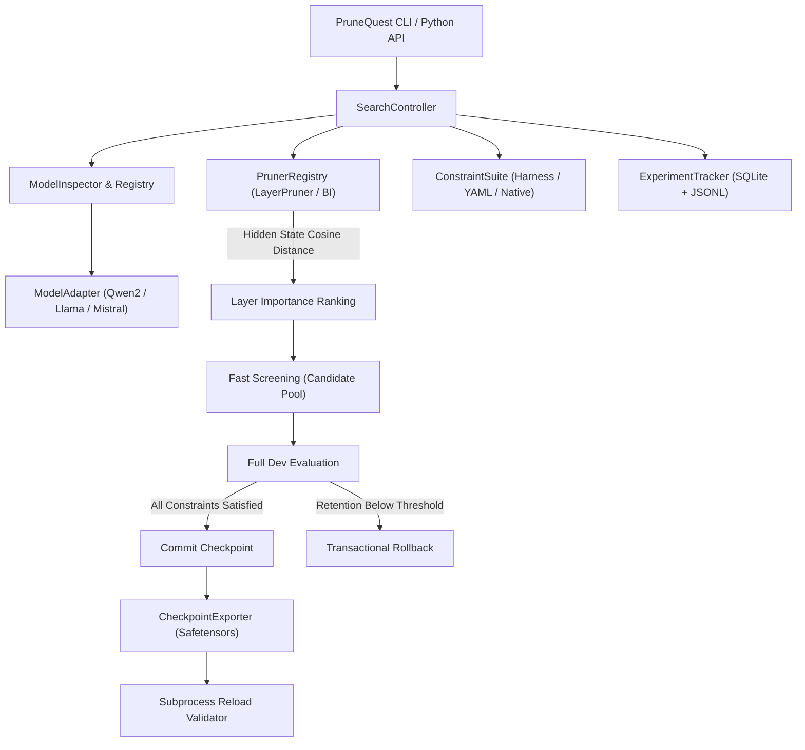

<p align="center">
  
</p>

# PruneQuest: Universal Benchmark-Driven LLM Pruning Framework

[](https://github.com/kaushikharsh99/PruneQuest/actions)
[](https://opensource.org/licenses/Apache-2.0)
[](https://www.python.org/downloads/)
[](https://pytorch.org/)
[](https://huggingface.co/)
[](https://github.com/EleutherAI/lm-evaluation-harness)

**PruneQuest** is an open-source, universal, benchmark-driven structural pruning framework designed to compress Large Language Models while strictly enforcing user-defined performance retention constraints.

Instead of applying blind heuristics or non-functional weight masking, PruneQuest **physically prunes transformer layers**, verifies functional integrity across single or multi-benchmark suites, and enforces strict directional performance retention thresholds (e.g. $\ge 99\%$ retention) with automatic transactional rollback.

---

## Key Highlights

- **Universal Architecture Discovery**: Automatic config inspection classifying models into `decoder_only_dense`, `mixture_of_experts`, `encoder_decoder`, `hybrid_ssm`, or `quantized` without heavy tensor downloads.
- **Multi-Family Support**: Production-verified adapters for **Qwen2/2.5**, **Llama-2/3**, and **Mistral**, with experimental adapters for **Gemma** and **Phi**.
- **EleutherAI LM-Evaluation Harness**: Native support for **14,222+ benchmarks** (GSM8K, ARC, HellaSwag, MMLU, Winogrande, etc.) evaluated in-memory without GPU memory duplication.
- **Declarative YAML `BenchmarkSpec`**: Define custom tasks from Hugging Face datasets, JSON/JSONL, CSV, or Parquet with built-in scorers (`exact_match`, `math_verify`, `normalized_match`, `regex`).
- **Multi-Benchmark `ConstraintSuite`**: Require candidates to satisfy retention thresholds across multiple benchmarks simultaneously before acceptance.
- **Physical Parameter Reduction**: Physically deletes transformer blocks from `torch.nn.ModuleList`, reducing parameter count, VRAM, and disk storage.
- **ShortGPT Block Influence Guidance**: Ranks candidate layers by token-level cosine distance across hidden representations, pruning redundant identity-like layers first.
- **Hardware-Conscious (6 GB VRAM Safe)**: Validated on an NVIDIA GeForce RTX 3050 Laptop GPU (6 GB VRAM, 16 GB RAM), with automatic garbage collection, CUDA cache clearing, and zero redundant allocations.
- **Production Checkpoint Export**: Saves standalone Hugging Face `safetensors` checkpoints with complete provenance metadata and verifies them via out-of-process reload testing.
- **CLI & Python API**: Feature-complete Rich / Typer CLI and Python API.

---

## Model Architecture Support & Capability Tiers

| Family | Architecture Class | Capability Level | Supported Pruning Operations |
| :--- | :--- | :--- | :--- |
| **Qwen 2 / 2.5** | `decoder_only_dense` | **Level 3 (Verified)** | Layer removal (Block Influence), SwiGLU MLP width slicing (FLAP), Joint Sweep (JIPO) |
| **Llama 2 / 3 / 3.1 / 3.2** | `decoder_only_dense` | **Level 3 (Verified)** | Layer removal (Block Influence), SwiGLU MLP width slicing (FLAP), Joint Sweep (JIPO) |
| **Mistral / Zephyr** | `decoder_only_dense` | **Level 3 (Verified)** | Layer removal (Block Influence), SwiGLU MLP width slicing (FLAP), Joint Sweep (JIPO) |
| **Gemma / Gemma-2** | `decoder_only_dense` | **Level 2 (Experimental)** | Physical layer removal, SwiGLU MLP intermediate slicing (experimental norm sync) |
| **Phi-2 / Phi-3 / 3.5** | `decoder_only_dense` | **Level 2 (Experimental)** | Physical layer removal (experimental RoPE/partial rotary; fused proj in Phi-3) |
| **Mixtral / Qwen-MoE** | `mixture_of_experts` | **Level 1 (Evaluation)** | Benchmark evaluation supported; expert pruning in dev |

---

## Empirical Results: Qwen2.5-Math-1.5B Full Sweep (JIPO)

Evaluated on an NVIDIA GeForce RTX 3050 Laptop GPU (6 GB VRAM) executing the Joint Incremental Pruning Optimizer (JIPO) on `Qwen/Qwen2.5-Math-1.5B-Instruct` across deterministic 512-sample GSM8K evaluation partitions with strict $\ge 95.0\%$ accuracy retention constraints:

| Iteration / Checkpoint | Active Layers | Intermediate Size | Parameter Count | Compression Ratio | GSM8K Accuracy (512 samples) | Accuracy Retention | Status |
| :--- | :--- | :--- | :--- | :--- | :--- | :--- | :--- |
| **Baseline (Original)** | 28 | 8,960 | 1,543,714,304 (1,543.71M) | 0.00% | 94.14% (482/512) | 100.00% | Unpruned Reference |
| **Iteration 1 (`flap_only_iter_1`)** | 28 | 8,512 | 1,485,911,552 (1,485.91M) | -3.74% (5.00% FLAP) | 93.95% (481/512) | 99.79% | Accepted |
| **Iteration 2 (`flap_only_iter_2`)** | 28 | 8,064 | 1,428,108,800 (1,428.11M) | -7.49% (10.00% FLAP) | 94.92% (486/512) | 100.83% | Accepted |
| **Iteration 3 (`flap_only_iter_3`)** | 28 | 7,616 | 1,370,306,048 (1,370.31M) | -11.23% (15.00% FLAP) | 93.16% (477/512) | 98.96% | Accepted |
| **Iteration 4 (`flap_only_iter_4`)** | 28 | 7,168 | 1,312,503,296 (1,312.50M) | -14.98% (20.00% FLAP) | 92.77% (475/512) | 98.55% | Accepted |
| **Iteration 5 (`flap_only_iter_5`)** | **28** | **6,720** | **1,254,700,544 (1,254.70M)** | **-18.72% (25.00% FLAP)** | **90.43% (463/512)** | **96.06%** | **Best Pareto Checkpoint** |

> **Key Finding**: PruneQuest compressed `Qwen/Qwen2.5-Math-1.5B-Instruct` down to **1,254,700,544 parameters** (removing **289.01M parameters**), reaching the configured 25.00% maximum compression limit while preserving **90.43% accuracy** (**96.06% retention** relative to the 94.14% baseline), passing all out-of-process reload and generation validation checks.

---

## Architecture Overview



---

## Quickstart

### 1. Installation

```bash
git clone https://github.com/kaushikharsh99/PruneQuest.git
cd PruneQuest

# Standard installation (CLI + core pruning framework)
pip install -e .

# Optional: with dev (pytest, ruff) and evaluation (lm-eval) suites
pip install -e ".[dev,eval]"
```

### 2. Verify Your Environment

Run system diagnostics to verify PyTorch, CUDA, and library dependencies (supports both GPU and CPU-only devices):

```bash
# General environment check
prunequest doctor

# FLAP-specific hardware diagnostics
prunequest flap doctor
```

### 3. Inspect Target Model

```bash
prunequest inspect --model meta-llama/Llama-3.2-1B-Instruct
prunequest inspect --model Qwen/Qwen2.5-Math-1.5B-Instruct

# Or inspect SwiGLU MLP channel dimensions directly via FLAP
prunequest flap inspect --model Qwen/Qwen2.5-Math-1.5B-Instruct
```

### 4. Discover Benchmarks

```bash
# List top discovered benchmarks
prunequest benchmarks list --limit 20

# Search available benchmarks
prunequest benchmarks search math
prunequest benchmarks search gsm8k

# Inspect task details
prunequest benchmarks info gsm8k
```

### 5. Launch Pruning Search

#### FLAP-Based: Structured Width / MLP Channel Pruning
Fluctuation-based Adaptive Structured Pruning on SwiGLU MLP intermediate projections with automatic step-back halving ($5\% \to 2.5\% \to 1.25\% \to 0.6125\%$) and VRAM-aware batched evaluation (up to batch size 64):
```bash
# 1. Profile FLAP layer importance scores
prunequest flap profile --config configs/qwen_math_flap.yaml

# 2. Run incremental width pruning optimization
prunequest flap-based optimize --config configs/qwen_math_flap.yaml --batch-size 32

# 3. Resume interrupted search from last accepted checkpoint
prunequest flap resume --config configs/qwen_math_flap.yaml

# 4. Evaluate exported checkpoint on GSM8K
prunequest flap test --checkpoint runs/qwen_math_flap/best --split test
```

#### Block-Based: Structured Depth / Layer Pruning
Autonomous search controller pruning redundant transformer blocks based on Block Influence hidden state cosine distance:
```bash
# Multi-benchmark pruning search with 99% retention target (dev split, or smoke for healthchecks)
prunequest block-based run \
    --model Qwen/Qwen2.5-Math-1.5B-Instruct \
    --benchmark gsm8k \
    --retain 0.99 \
    --max-iterations 3 \
    --split dev \
    --output ./runs/qwen_block_run

# Or inspect model layer rankings using the 'block' alias
prunequest block inspect --model Qwen/Qwen2.5-Math-1.5B-Instruct
```

#### Full Sweep / Full Pass Pruning (JIPO)
Joint Incremental Pruning Optimizer (JIPO) dynamically unifies structured depth (Block Influence layer excision) and width (FLAP MLP intermediate channel slicing) pruning into a progressive 3-level search:
- **Level 1 (Cheap Importance Profiling)**: Calculates Block Influence scores and FLAP channel statistics using calibration forward passes without generating answers; profiles are cached and selectively invalidated on structural modifications.
- **Level 2 (Cheap Combined Screening)**: Slices candidate channels and layer in-memory and screens teacher-forced loss on a small calibration-independent subset before invoking full benchmarks.
- **Level 3 (Adaptive Multi-Benchmark Validation)**: Validates surviving joint candidates against full accuracy retention constraints. If the joint candidate passes, both operations are accepted and committed; if it fails, single-operation alternatives ($C_2 = M \setminus \{B\}$ and $C_3 = M \setminus \{F\}$) are evaluated based on utility score $U(C) = \frac{\Delta\text{Bytes}}{\epsilon + \text{Loss}}$.
- **Pareto Tracking & SQLite Persistence**: Tracks the multi-dimensional Pareto frontier of accuracy vs. parameter reduction, logs evaluations saved, and automatically exports the dominant checkpoint.

```bash
# Execute Joint Incremental Pruning Optimizer
prunequest full-sweep --config configs/full_sweep.yaml

# Or using the alias with runtime overrides and automatic checkpoint resumption:
prunequest full-pass \
  --config configs/full_sweep.yaml \
  --model "Qwen/Qwen2.5-Math-1.5B-Instruct" \
  --retain 0.95 \
  --max-iterations 10 \
  --batch-size 64 \
  --device "cuda:0" \
  --output "runs/full_sweep" \
  --resume
```

### 6. Python API Example

```python
from prunequest import PruneQuest

quest = PruneQuest(
    model="Qwen/Qwen2.5-Math-1.5B-Instruct",
    benchmarks=["gsm8k"],
    retain=0.99,
    max_iterations=3,
    split="smoke",
)

result = quest.run()

print(f"Status: {result.status}")
print(f"Best checkpoint exported to: {result.best_checkpoint}")
print(f"Parameters pruned: {result.original_params - result.final_params:,}")
print(f"Final accuracy retention: {result.accuracy_retention_pct:.2f}%")
```

---

## Declarative Benchmark Specifications

PruneQuest allows custom benchmarks to be specified via declarative YAML:

```yaml
version: 1
name: custom_qa
dataset:
  path: json
  data_files: data/qa.jsonl
prompt_template: "Question: {question}\nAnswer:"
scoring:
  metric: exact_match
splits:
  dev:
    samples: 100
  test:
    samples: 500
```

Validate and preview YAML specs using the CLI:

```bash
prunequest benchmarks validate --spec benchmark.yaml
prunequest benchmarks preview --spec benchmark.yaml --limit 3
```

---

## Roadmap

- [x] **v0.1.0**: Initial foundational release (Qwen2 adapter, layer pruning, Block Influence, GSM8K, Typer CLI, SQLite tracking).
- [x] **v0.1.1**: Reliability & Benchmark Correctness (Two-phase candidate screening and dev benchmark validation, baseline preservation on resume, subprocess reload validation rejection safeguards, strict Ruff CI pass, expanded offline unit testing suite).
- [x] **v0.2.0**: Universal LLM Pruning Framework (ModelInspector architecture discovery, 4 capability tiers, LLaMA-2/3, Mistral, Gemma, and Phi adapters, LM Evaluation Harness integration with 14,222+ tasks, declarative YAML BenchmarkSpec compiler, directional MetricSpec and multi-benchmark ConstraintSuite).
- [x] **v0.3.0**: Granular MLP Width Pruning: FLAP-based SwiGLU intermediate channel slicing, proxy screening, adaptive step-back halving, and VRAM-conscious batched GSM8K evaluation.
- [ ] **v0.4.0**: Granular Head Pruning: Multi-head / Grouped-query attention head pruning with dynamic projection recalculation and multi-GPU DDP search support.

---

## Contributing

Contributions are warmly welcomed! Please see [CONTRIBUTING.md](CONTRIBUTING.md) and [CODE_OF_CONDUCT.md](CODE_OF_CONDUCT.md) for details on filing issues, opening PRs, and running tests.

---

## License

PruneQuest is licensed under the [Apache-2.0 License](LICENSE).
