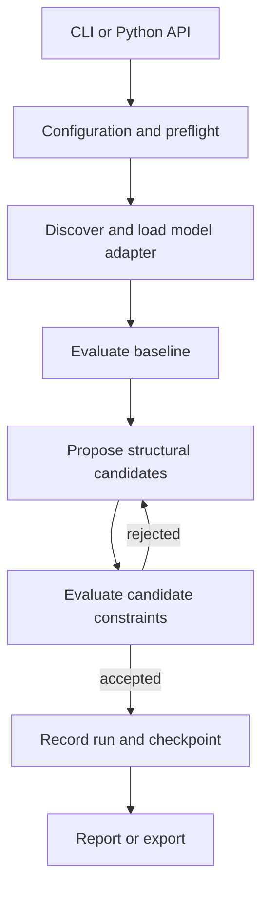

# Architecture

PruneQuest is a Python package organized around model handling, evaluation, pruning, orchestration, persistence, and optional local Studio UI. The CLI and public Python API are entry points over these package modules.

## Package map

| Area | Location | Responsibility |
| --- | --- | --- |
| CLI and Python API | `src/prunequest/cli.py`, `src/prunequest/api.py` | User-facing command and library entry points. |
| Models | `src/prunequest/models/` | Architecture discovery, adapter implementations, and model registry. |
| Pruning | `src/prunequest/pruning/`, `src/prunequest/flap/` | Layer pruning, width slicing, scoring, and FLAP workflow. |
| Orchestration | `src/prunequest/core/`, `src/prunequest/orchestrator/`, `src/prunequest/sweep/` | Search control, strategy selection, configuration, and joint sweeps. |
| Evaluation | `src/prunequest/benchmarks/`, `src/prunequest/datasets/` | Benchmark adapters, metric constraints, dataset inspection, and specs. |
| Runs and reporting | `src/prunequest/runs/`, `src/prunequest/core/tracking.py`, `src/prunequest/reporting/` | Run metadata, event history, and reports. |
| Export | `src/prunequest/export/`, `src/prunequest/flap/export/` | Checkpoint writing and validation helpers. |
| Studio | `src/prunequest/studio/`, `frontend/` | Optional local web API and browser UI. |

## Typical optimization flow

Concrete behavior varies by selected workflow. Consult the relevant implementation and CLI help rather than assuming every workflow uses every stage shown above.

## Design constraints

- Pruning is intended to change model structure physically; a mask alone is not equivalent to structural compression.
- Model adapter responsibilities include locating the relevant modules and keeping architecture metadata consistent after structural changes.
- Evaluation requirements are expressed through benchmark implementations and metric/constraint code. Acceptance behavior must be verified in the selected workflow.
- Run formats and checkpoint validation are implementation details that may evolve. Prefer the run readers and exporters over hard-coding undocumented artifact layouts.
- The Studio server is optional and intended for local use. Review `src/prunequest/studio/security/` when changing its request handling or binding behavior.

## Persistence

Run state, events, checkpoints, and generated reports are handled by separate modules. Use `src/prunequest/runs/` and `src/prunequest/core/tracking.py` as the source of truth for current persistence behavior; this document avoids promising a fixed schema beyond what those implementations guarantee.
